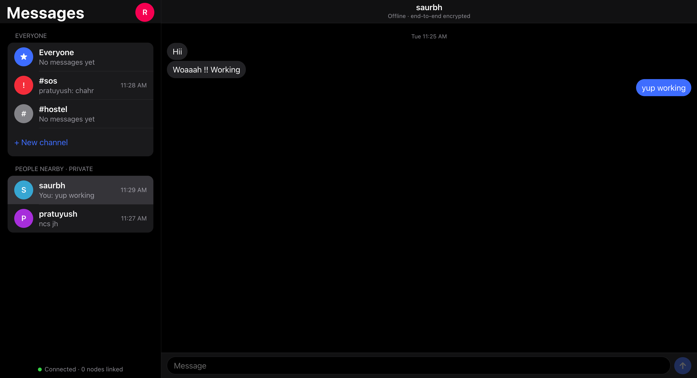

# MeshLink

<p align="center">
  
</p>

<p align="center">
  <em>Offline-first mesh chat for a local network — no internet, no central server.</em>
</p>


Offline-first mesh chat for a local network. When the internet is shut down, everyone still on the same wifi can keep talking: public channels, private end-to-end encrypted chats, and an SOS alert. One binary, zero dependencies.

## Problem
Internet shutdowns in Manipur are frequent and can last days. At campus, hostel wifi (LAN) usually keeps working even when the uplink is cut, but every chat app depends on cloud servers, so students can't reach each other or raise an alert. MeshLink needs no internet and no server.

## Features
- **Everyone channels**: `Everyone`, `#hostel`, `#sos`, and custom channels
- **Private chats**: end-to-end encrypted in the browser (X25519 + XSalsa20-Poly1305, via TweetNaCl). Relaying nodes see only ciphertext
- **SOS**: red alert to all nodes, vibrates phones
- **Presence**: "People nearby" list with online status
- **Zero setup for users**: open `http://<node-ip>:8080` on any phone or laptop, no app install
- **Resilient**: auto-discovery, reconnect, store-and-forward history sync, persisted message log

## How it works
```
 phone/laptop browser  <-- HTTP + SSE -->  node  <-- TCP mesh -->  node  <-->  node
```
- **Discovery**: UDP broadcast beacons on the LAN, plus peer-list gossip so nodes across subnets/APs link once any path exists. `--peer ip:9000` bootstraps manually
- **Transport**: newline-delimited JSON over TCP; duplicate-link tie-break (lower initiator ID wins); keepalives
- **Routing**: flooding with message-ID dedupe; last 400 messages synced on connect, so offline nodes catch up
- **Integrity**: every message is ed25519-signed by its node and verified at every hop
- **Presence**: rate-limited, TTL-bounded flood of heartbeats
- **Stack**: Go standard library only (+ embedded vanilla JS UI), cross-compiles to Windows/Linux/Mac/ARM

## Run
```
go run . --nick yourname        # or download a binary from Releases
```
Open a URL it prints. Run on more laptops on the same wifi to extend the mesh.
Flags: `--http 8080 --mesh 9000 --disco 9999 --data ./data --peer ip:9000`

Firewall: allow TCP 8080, 9000 and UDP 9999 on the private network. The router must not have AP/client isolation enabled.

## Limitations
- Public messages are signed per node, not per user, so a user on the LAN can impersonate a name in public channels (private chats are authenticated by encryption)
- Identity key lives in the browser; clearing site data loses private history
- No rate limiting or moderation yet
- Requires a working LAN; it doesn't create wifi by itself

## Roadmap
- Per-user signing keys, rate limiting, file/image sharing
- Bluetooth/Wi-Fi Direct for LAN-less mesh, Android app